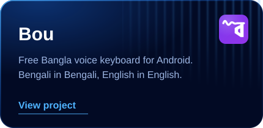

  

  
  
  

 

<picture>
  <source media="(prefers-color-scheme: dark)" srcset="assets/h-work-dark.svg">
  
</picture>

  
  

 

<picture>
  <source media="(prefers-color-scheme: dark)" srcset="assets/h-tools-dark.svg">
  
</picture>

 

<picture>
  <source media="(prefers-color-scheme: dark)" srcset="assets/h-github-dark.svg">
  
</picture>

  

 

  

