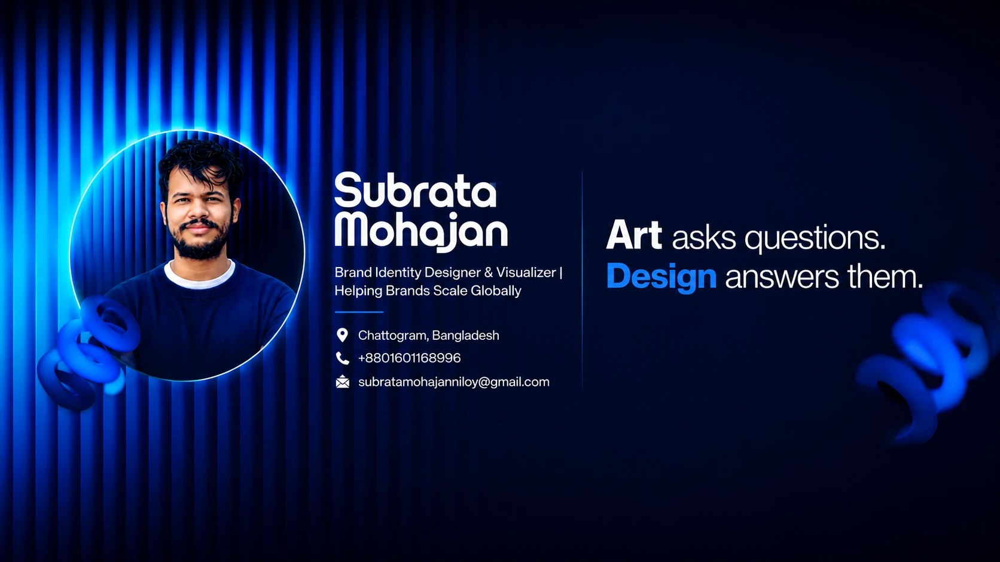
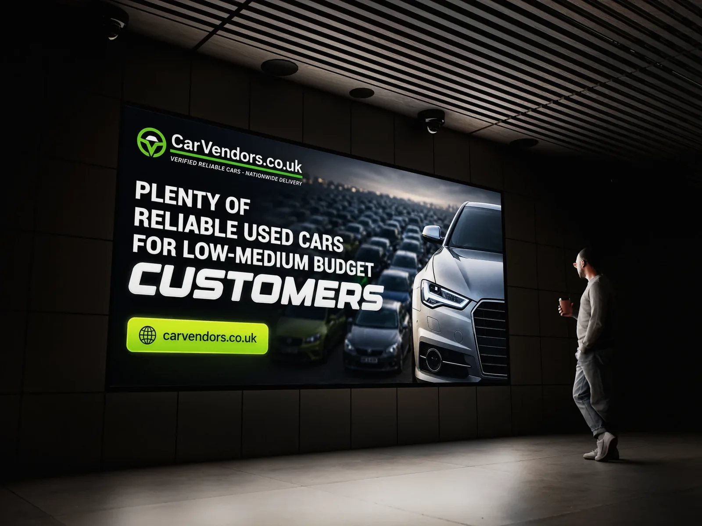
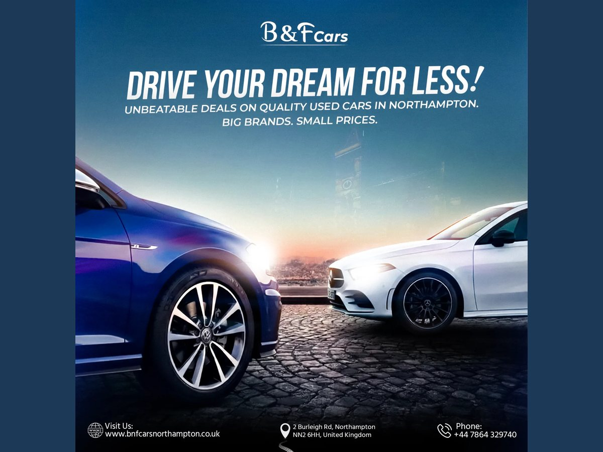
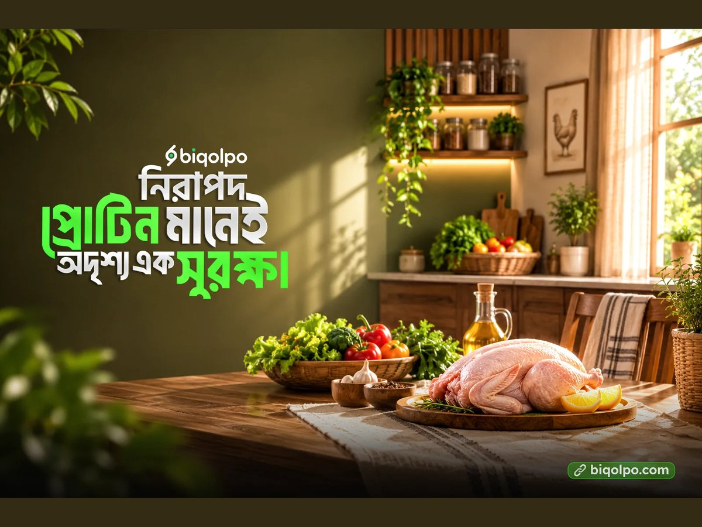
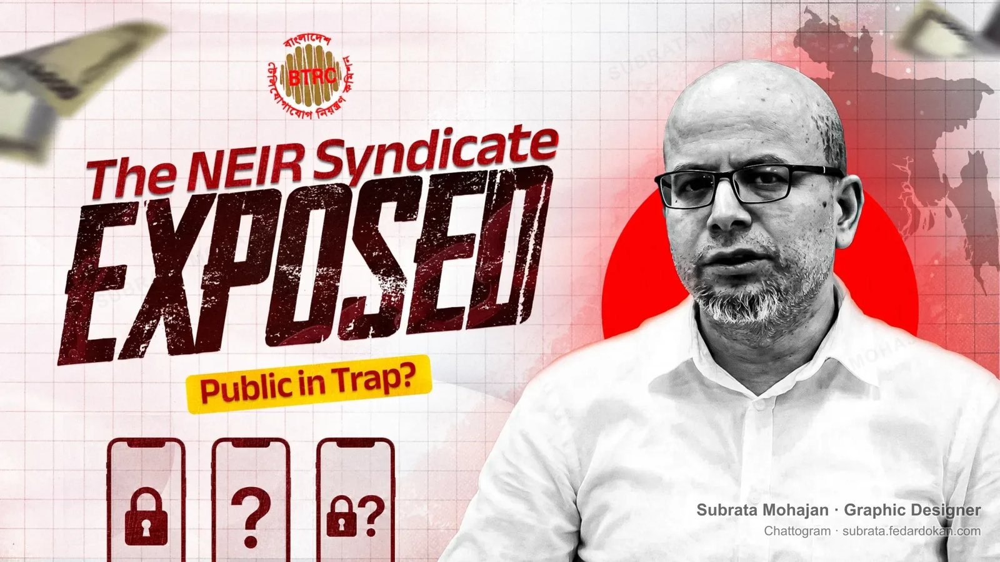
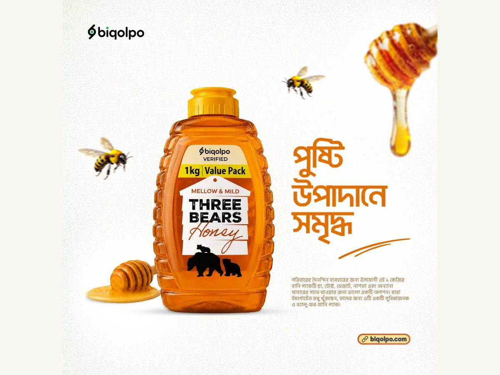
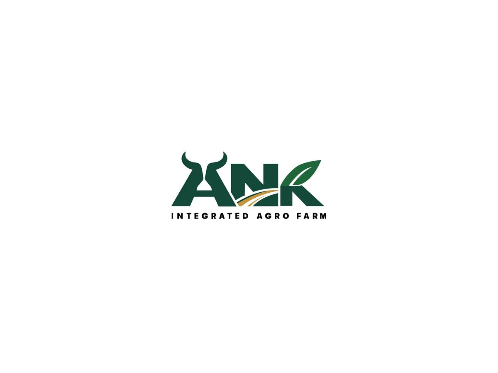

  

<h3 align="center">
  <a href="https://subrata.fedardokan.com/portfolio/">Portfolio</a>&nbsp;&nbsp;&nbsp;&nbsp;
  <a href="https://subrata.fedardokan.com/services/">Services</a>&nbsp;&nbsp;&nbsp;&nbsp;
  <a href="https://subrata.fedardokan.com/contact/">Hire me</a>
</h3>

 

## Selected work

**LED billboard for CarVendors.co.uk**

 

  
  

Social media posters for B &amp; F Cars and Biqolpo.

 

  
  

YouTube thumbnail for The NEIR Syndicate, a honey launch poster for Biqolpo, and a logo for ANK Integrated Agro Farm.

<a href="https://subrata.fedardokan.com/portfolio/">See the full portfolio</a>

 

## Also building

**[Bou](https://github.com/subrata-mohajan/Bou)**, a free Bangla voice keyboard for Android: speak Bengali, it writes Bengali, and English words stay English.

 

Like my work? <a href="https://www.supportkori.com/subratamohajan">Support me on SupportKori</a>

